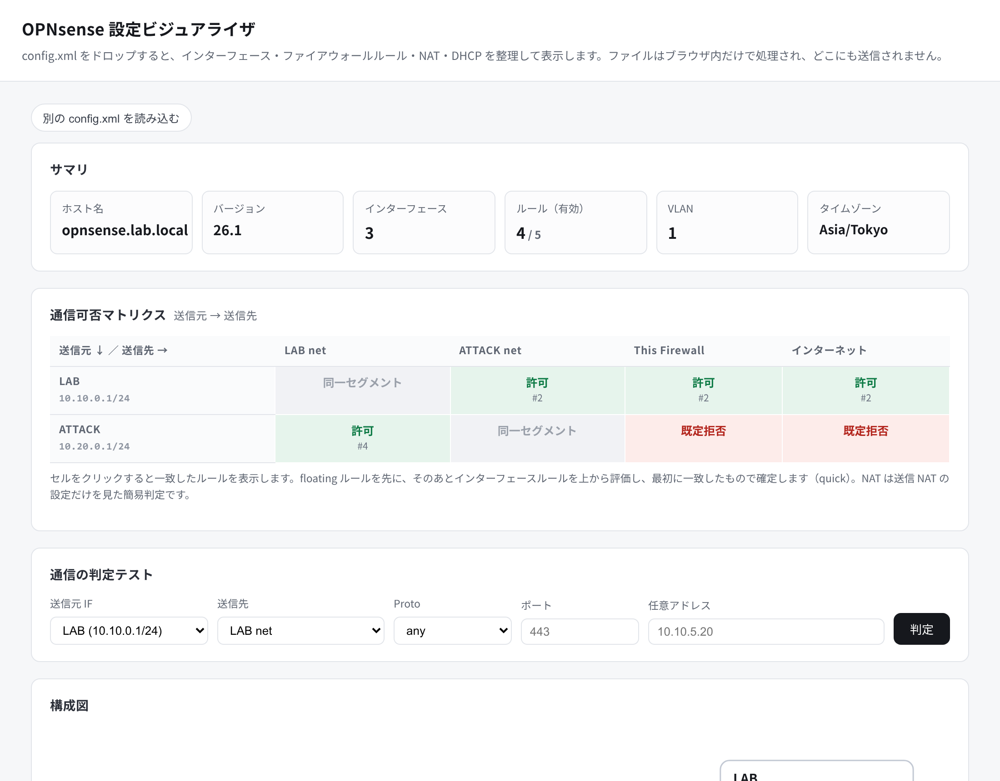

# OPNsense Config Visualizer

OPNsense の `config.xml`（System → Configuration → Backups でダウンロードしたもの）を読み込み、**どの通信が許可され、どれが拒否されるか**を中心に可視化する単一ファイルのツールです。ビルド不要、依存なし、オフラインで動作します。

## 特徴

- **通信可否マトリクス** — 送信元インターフェース × 送信先（各セグメント / This Firewall / インターネット）で、許可・拒否を一覧表示。セルをクリックすると一致したルールを表示
- **通信の判定テスト** — 送信元 IF・送信先・プロトコル・ポートを指定して、実際にどのルールで確定するかを確認
- **構成図** — WAN を上流、LAN / OPT を下流に置いた SVG。各ノードに pass / block の件数
- **ファイアウォールルール一覧** — 評価順に並べ、インターフェースごとのタブと検索。無効ルールは打ち消し線
- **気になるところ（簡易チェック）** — WAN の全許可、説明のないルール、NAT が Automatic で攻撃セグメントも NAT される、DHCP の二重配布など
- インターフェース、NAT（送信 NAT / ポートフォワード）、エイリアス、DHCP、ゲートウェイ、VLAN の一覧

## 使い方

1. `index.html` をブラウザで開く
2. `config.xml` をドロップ（またはクリックして選択）
3. 表示された内容を確認。`Ctrl+P` で PDF にできます

`examples/sample-config.xml` で動作を試せます。

ファイルはブラウザ内だけで処理され、外部に送信されません。サーバーも通信も不要です。

## 判定ロジック

pf / OPNsense の挙動に寄せた簡易シミュレーションです。

1. floating ルールを先に、そのあと送信元インターフェースのルールを上から評価
2. 最初に一致したルールで確定（quick）
3. 一致がなければ、そのインターフェースの既定拒否
4. 一致条件は、プロトコル / 送信元アドレス / 送信先アドレス / 送信先ポート
5. インターネット向けは、あわせて送信 NAT の有無も判定（NAT がなければ到達不可として表示）

## 制限

- IPv4 のみ判定します（IPv6 のルールは評価対象外）
- ルールの `direction out` と floating の out 方向は評価しません
- NAT リフレクション、ポートフォワード経由の到達性、ポリシールーティング（ゲートウェイ指定）は判定に含みません
- 表示は設定ファイルの静的な解析結果です。実際の状態（`pfctl -sr` の出力）とは差異が出る場合があります

## 動作環境

モダンブラウザ（Chrome / Edge / Firefox / Safari）。`DOMParser` と SVG しか使っていません。

## ライセンス

MIT
